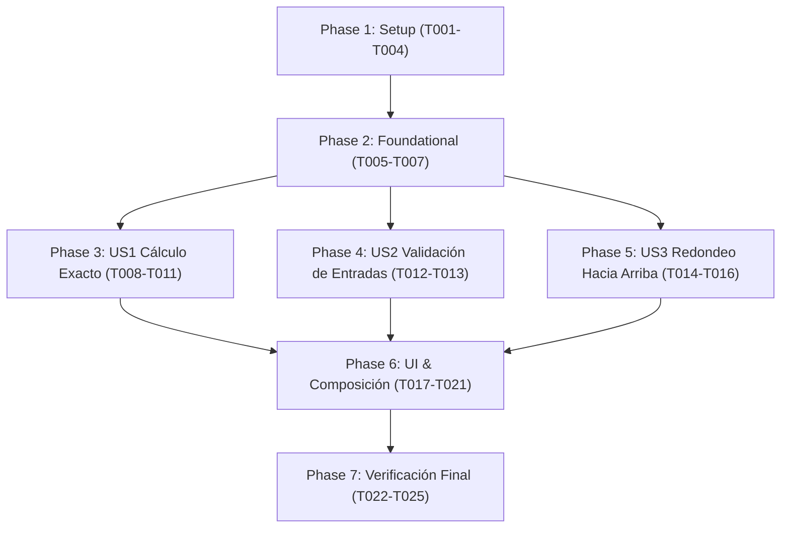

# Tasks: División de Cuenta Web

**Input**: Design documents from `specs/001-dividir-cuenta/`
**Prerequisites**: [plan.md](plan.md), [spec.md](spec.md), [research.md](research.md), [data-model.md](data-model.md), [contracts/divisor-contract.md](contracts/divisor-contract.md), [quickstart.md](quickstart.md), [.specify/memory/constitution.md](../../.specify/memory/constitution.md)

## Format: `- [ ] [TaskID] [P?] [Story?] Description with file path`
- **[P]**: Ejecución paralela (archivos independientes sin bloqueos)
- **[Story]**: Mapeo a historia de usuario ([US1], [US2], [US3])
- Rutas de archivo exactas en cada tarea

---

## Phase 1: Setup (Shared Infrastructure)

**Purpose**: Inicialización del entorno de pruebas, estructura de directorios y utilidades transversales

- [x] T001 Configurar entorno de pruebas agregando dependencias de Vitest (`vitest`, `@testing-library/react`, `@testing-library/jest-dom`, `jsdom`) y scripts en `package.json` y `vite.config.js`
- [x] T002 [P] Crear la estructura de carpetas de capas en `src/domain/`, `src/data/`, `src/presentation/`, `test/unit/domain/`, `test/unit/data/`, `test/unit/presentation/` y `test/component/`
- [x] T003 [P] Implementar la utilidad `formatearMoneda` en `src/presentation/formateadorMoneda.js` para formatear valores numéricos a dos decimales exactos (`valor.toFixed(2)`)
- [x] T004 [P] Crear pruebas unitarias para `formatearMoneda` en `test/unit/presentation/formateadorMoneda.test.js` validando formateos estándar (e.g. 27.5 -> "27.50", 30 -> "30.00", 3.33 -> "3.33", 4 -> "4.00")

---

## Phase 2: Foundational (Blocking Prerequisites)

**Purpose**: Modelos inmutables y abstracciones del dominio en JavaScript puro (sin React ni DOM) que bloquean las historias de usuario

**⚠️ CRITICAL**: La implementación de historias de usuario no puede iniciar hasta que esta fase esté completada.

- [x] T005 [P] Definir el contrato de `EstrategiaRedondeo` en `src/domain/estrategiaRedondeo.js` que especifica el método `aplicar(valor: number): number` (JavaScript puro)
- [x] T006 [P] Crear la factoría inmutable de la entidad `Cuenta` en `src/domain/cuenta.js` validando los campos: `montoBase` (número finito > 0), `numeroPersonas` (entero positivo >= 1), `porcentajePropina` (número >= 0) y `estrategiaRedondeo` (objeto con función `aplicar`)
- [x] T007 [P] Crear la factoría inmutable de la entidad `Resultado` en `src/domain/resultado.js` conteniendo los campos numéricos `montoPorPersona`, `totalPropina` y `totalPagar` (JavaScript puro)

**Checkpoint**: Base del dominio lista - las historias de usuario pueden implementarse ahora.

---

## Phase 3: User Story 1 - Cálculo de División Equitativa en Modo Exacto (Priority: P1) 🎯 MVP

**Goal**: Permitir calcular la división equitativa de la cuenta con propina en modo exacto (redondeo estándar a 2 decimales).

**Independent Test**: Escenario 1 (Monto: 100.00, 4 personas, 10% -> "27.50"), Escenario 2 (Monto: 90.00, 3 personas, 0% -> "30.00") y Escenario 3 (Monto: 10.00, 3 personas, 0% -> "3.33").

### Tests para User Story 1

- [x] T008 [P] [US1] Escribir pruebas unitarias para `redondeoExacto` en `test/unit/data/redondeoExacto.test.js` verificando redondeo a 2 decimales estándar (`Math.round(valor * 100) / 100`)
- [x] T009 [P] [US1] Escribir pruebas unitarias para el caso de uso `calcularDivision` en `test/unit/domain/calcularDivision.test.js` cubriendo los escenarios 1 (100.00, 4, 10% -> 27.50), 2 (90.00, 3, 0% -> 30.00) y 3 (10.00, 3, 0% -> 3.33)

### Implementación para User Story 1

- [x] T010 [P] [US1] Implementar la estrategia `redondeoExacto` en `src/data/redondeoExacto.js` cumpliendo el contrato `EstrategiaRedondeo` con fórmula `Math.round(valor * 100) / 100`
- [x] T011 [US1] Implementar la función pura `calcularDivision` en `src/domain/calcularDivision.js` que recibe `Cuenta` y devuelve `Resultado` aplicando la estrategia de redondeo inyectada sin formatear ni validar

**Checkpoint**: User Story 1 completamente funcional a nivel de lógica de dominio y datos.

---

## Phase 4: User Story 2 - Validación de Entradas y Manejo de Errores (Priority: P1)

**Goal**: Validar las entradas del usuario, emitiendo mensajes de error específicos ("Monto inválido", "Debe haber al menos una persona") y bloqueando el cálculo ante datos erróneos.

**Independent Test**: Escenario 4 (Monto 50.00, 0 personas -> error "Debe haber al menos una persona" sin resultado) y Escenario 5 (Monto "abc" -> error "Monto inválido" sin resultado).

### Tests para User Story 2

- [x] T012 [P] [US2] Escribir pruebas unitarias para `validarEntrada` en `test/unit/domain/validarEntrada.test.js` verificando los escenarios 4 (personas = 0) y 5 (monto = "abc"), así como montos negativos y vacíos

### Implementación para User Story 2

- [x] T013 [US2] Implementar el módulo `validarEntrada` en `src/domain/validarEntrada.js` con las funciones `validarMonto(texto)`, `validarPersonas(texto)` y `validarPropina(texto)` devolviendo cadenas de error o `null` si son válidas (JavaScript puro)

**Checkpoint**: User Story 2 funcional; las validaciones de dominio están cubiertas de forma aislada.

---

## Phase 5: User Story 3 - Redondeo hacia Arriba al Entero más Cercano (Priority: P2)

**Goal**: Permitir seleccionar el modo de redondeo hacia arriba elevando la cuota por persona al entero superior inmediato.

**Independent Test**: Escenario 6 (Monto: 10.00, 3 personas, 0% propina, modo hacia arriba -> "4.00").

### Tests para User Story 3

- [x] T014 [P] [US3] Escribir pruebas unitarias para `redondeoHaciaArriba` en `test/unit/data/redondeoHaciaArriba.test.js` verificando elevación al entero superior con `Math.ceil(valor)`

### Implementación para User Story 3

- [x] T015 [P] [US3] Implementar la estrategia `redondeoHaciaArriba` en `src/data/redondeoHaciaArriba.js` cumpliendo el contrato `EstrategiaRedondeo` con fórmula `Math.ceil(valor)`
- [x] T016 [US3] Extender las pruebas unitarias en `test/unit/domain/calcularDivision.test.js` para verificar el escenario 6 (10.00, 3 personas, 0% propina, hacia arriba -> cuota 4.00)

**Checkpoint**: Todas las reglas de negocio y estrategias de cálculo de las tres historias de usuario están verificadas.

---

## Phase 6: UI, Presentación y Composición (Presentation Layer)

**Goal**: Conectar el dominio y los datos con la interfaz de usuario en React mediante el custom hook `useDivisor`, componentes visuales y el punto de composición único en `src/main.jsx`.

### Tests para la Capa de Presentación

- [x] T017 [P] [US1] Escribir pruebas unitarias para el hook `useDivisor` en `test/unit/presentation/useDivisor.test.js` verificando inyección de dependencias, valores por defecto (propina 10%, modo exacto), manejo de errores y emisión de resultados
- [x] T018 [P] [US1] Escribir pruebas de componentes e interacción para `PantallaDivisor` en `test/component/PantallaDivisor.test.jsx` validando los 6 escenarios de aceptación completos interactuando con el DOM emulado

### Implementación para la Capa de Presentación

- [x] T019 [US1] Implementar el custom hook `useDivisor` en `src/presentation/useDivisor.js` que RECIBE sus dependencias inyectadas (`calcularDivision`, `validarEntrada`, `estrategias`), maneja el estado local con `useState` e implementa la acción `calcular()`
- [x] T020 [US1] Implementar la vista `PantallaDivisor` en `src/presentation/PantallaDivisor.jsx` con formulario de entradas, selector de modo de redondeo, botón "Calcular", presentación de errores y panel de resultados formateados con `formatearMoneda`
- [x] T021 [US1] Configurar `src/main.jsx` como el ÚNICO punto de composición e instanciación que importa de `src/data/` (`redondeoExacto`, `redondeoHaciaArriba`) y `src/domain/` (`calcularDivision`, `validarEntrada`), ensambla las dependencias y renderiza `<PantallaDivisor dependencias={...} />`

**Checkpoint**: Aplicación completamente ensamblada y funcional en la interfaz de usuario.

---

## Phase 7: Polish & Cross-Cutting Concerns

**Purpose**: Verificación final de calidad, cumplimiento constitucional y ejecución de validaciones transversales

- [x] T022 Ejecutar análisis estático con Oxlint mediante `npm run lint` y verificar 0 advertencias y 0 errores
- [x] T023 Ejecutar la suite completa de pruebas automatizadas con `npx vitest run` y certificar el 100% de tests pasando
- [x] T024 Auditar el aislamiento del dominio verificando que ningún archivo bajo `src/domain/` importe React, hooks ni APIs del DOM
- [x] T025 Ejecutar la guía de validación rápida de extremo a extremo descrita en `specs/001-dividir-cuenta/quickstart.md`

---

## Dependencies & Completion Order

---

## Parallel Execution Opportunities

- **Fase 1 (Setup)**: T002, T003 y T004 pueden ejecutarse en paralelo una vez configurado T001.
- **Fase 2 (Foundational)**: T005 (`estrategiaRedondeo.js`), T006 (`cuenta.js`) y T007 (`resultado.js`) son archivos independientes y pueden desarrollarse en paralelo.
- **Fases 3, 4 y 5**: Tras completar la fase Foundational, las tres historias de usuario pueden desarrollarse en paralelo:
  - US1: T008, T009 y T010 pueden ejecutarse en paralelo antes de T011.
  - US2: T012 y T013 pueden ejecutarse de forma independiente.
  - US3: T014 y T015 pueden ejecutarse de forma independiente antes de T016.
- **Fase 6 (Presentation)**: Los tests T017 y T018 pueden prepararse en paralelo con la implementación de T019 y T020 antes del ensamblado final en T021.

---

## Implementation Strategy

### MVP First (User Story 1 Only)
1. Completar Fase 1 (Setup) y Fase 2 (Foundational).
2. Implementar Fase 3 (User Story 1: Cálculo exacto y propina).
3. Conectar en `useDivisor.js`, `PantallaDivisor.jsx` y `src/main.jsx`.
4. **Validar MVP**: Ejecutar pruebas de los escenarios 1, 2 y 3. La app ya calcula y divide cuentas.

### Entrega Incremental
1. Base y US1 lista $\rightarrow$ MVP funcional.
2. Incorporar US2 $\rightarrow$ Robustez con validaciones inmediatas y mensajes de error ("Monto inválido", "Debe haber al menos una persona").
3. Incorporar US3 $\rightarrow$ Selector de redondeo hacia arriba al entero más cercano.
4. Ensamblaje en UI y verificación final con Oxlint y Vitest.

